  

  
  
  
  

### `~/about`

I'm a **Data Scientist** who builds ML that ships, from survival-analysis churn models and recommender systems serving 1M+ users to LLM agents and RAG services. I'm also a **published researcher** in federated spatiotemporal forecasting. I care about models that are measurable, explainable, and useful to the people acting on them.

- 🎓 B.Tech, Computer and Electronics Engineering, **VIT Chennai** (2022 – 2026, CGPA 8.29)
- 💼 Data Science Intern, **Niyo Solutions** (Apr – Oct 2026)
- 🧠 AI Analyst (RLHF), **Deccan AI** (Dec 2025 – Apr 2026)
- 📄 Published in **Scientific Reports (2026)**: [*Federated spatial-temporal traffic forecasting with VMD-enhanced graph attention and LSTM*](https://www.nature.com/articles/s41598-026-37917-w)

### `~/impact`

  

<b>What I built at Niyo</b> (production ML, Apr – Oct 2026)

 

- **Churn and retention:** a CatBoost classifier plus Cox regression survival model on 1M+ users. It reached 0.92 AUC and 90.1% precision and cut retention campaign spend 98% compared with full-base broadcast.
- **Recommendation:** clustered 89.6M events into 10 affinity segments (89% accuracy), which raised notification CTR **28×**. The lift was validated with A/B hypothesis testing.
- **Campaign tagging:** a hybrid keyword-rule plus sentence-transformer NLP pipeline. It tags 1,643 campaigns in under 5 s, runs fully on local infrastructure, and makes no external API calls.
- **Support routing:** a LightGBM multi-class model tuned with Optuna, using 51 behavioural features. It routes across 19 intents at 72% top-5 accuracy with under 2 s latency.
- **KYC automation:** a CV + OCR pipeline (PyTorch CNN, Mahalanobis open-set detection, RapidOCR) served through FastAPI and Docker, with CI/CD and model monitoring.

### `~/projects`

<table>
<tr>
<td width="50%" valign="top">

#### 🛰️ [Federated Spatiotemporal Traffic Forecasting](https://github.com/sanyam03-hub/fed-lstmdstgcrn_csv_vmd)
📄 Published in <a href="https://www.nature.com/articles/s41598-026-37917-w"><b>Scientific Reports (2026)</b></a> · <a href="https://www.nature.com/articles/s41598-026-37917-w">Read the paper</a>

A hybrid **LSTM-DSTGCRN** with VMD decomposition and adaptive adjacency that reduces forecasting error on sensor data compared with baseline models. It trains with **federated learning**, so raw data never leaves its source, and uses selective update integration to prevent negative transfer.

`Python` `Graph Neural Nets` `Federated Learning` `Time Series`

</td>
<td width="50%" valign="top">

#### ⚡ [EdgeBench](https://github.com/sanyam03-hub/EdgeBench)
A config-driven tool that converts PyTorch models to **ONNX Runtime (FP32/INT8)**, checks that outputs still match, and benchmarks latency, size and accuracy. A CI gate fails the build when a conversion regresses. On ResNet-18, static INT8 runs at **6.17 ms** p50 versus 30.68 ms in PyTorch, for −1.5 pts top-1.

`PyTorch` `ONNX Runtime` `Quantization` `CI`

</td>
</tr>
<tr>
<td width="50%" valign="top">

#### 🤖 [AI Data Agent](https://github.com/sanyam03-hub/Data_agent)
An LLM agent that lets non-technical users **query databases in plain English**. It includes automated data ingestion and validated, safe SQL generation, in a modular architecture built for reproducible deployment.

`LangChain` `LangGraph` `PostgreSQL` `Pydantic` `uv`

</td>
<td width="50%" valign="top">

#### 📚 [Production-Grade RAG System](https://github.com/sanyam03-hub/Production-Grade-Retrieval-Augmented-Generation-System-for-Technical-Docs-main)
Semantic search over large sets of technical documents. The pipeline covers chunking, embeddings and **FAISS** indexing behind a FastAPI retrieval service, with a Node API gateway. It's deployed on Render with rate limiting, ingestion monitoring, and similarity scores shown for transparency.

`FAISS` `Sentence-Transformers` `FastAPI` `Node.js`

</td>
</tr>
<tr>
<td colspan="2" valign="top">

#### 📡 [Telecom Revenue Optimization Model](https://github.com/sanyam03-hub/Telecom-Revenue-Optimization-Model)
EDA and statistical testing on 20+ variables for 7K+ customers, which found the drivers behind **22% high-risk churn**. The churn model reaches **0.87 ROC-AUC**. A KPI dashboard tracks 10+ metrics and shows that **35% of revenue** comes from high-value customers.

`Python` `scikit-learn` `Statistical Testing` `Dashboards`

</td>
</tr>
</table>

### `~/stack`

  

| Area | Tools |
|---|---|
| **Data & Statistics** | Python (pandas, NumPy) · SQL · EDA · A/B testing · survival analysis · time-series forecasting |
| **Machine Learning** | scikit-learn · CatBoost · LightGBM · TensorFlow · PyTorch · NLP · computer vision · LLMs / RAG |
| **MLOps & Data Platforms** | FastAPI · Docker · CI/CD · Kong · Databricks · Spark · Azure · MySQL · MongoDB |
| **Visualization & BI** | Power BI · Matplotlib · Seaborn · Streamlit · Excel |
| **Collaboration** | Git / Bitbucket · Jira · Confluence · Postman |

### `~/activity`

  <picture>
    <source media="(prefers-color-scheme: dark)" srcset="https://raw.githubusercontent.com/sanyam03-hub/sanyam03-hub/output/snake-dark.svg"/>
    <source media="(prefers-color-scheme: light)" srcset="https://raw.githubusercontent.com/sanyam03-hub/sanyam03-hub/output/snake-light.svg"/>
    
  </picture>

  
  

Live data from GitHub via <a href="https://github.com/Platane/snk">snk</a>, <a href="https://github.com/anuraghazra/github-readme-stats">github-readme-stats</a> and <a href="https://github.com/DenverCoder1/github-readme-streak-stats">streak-stats</a>.

  

